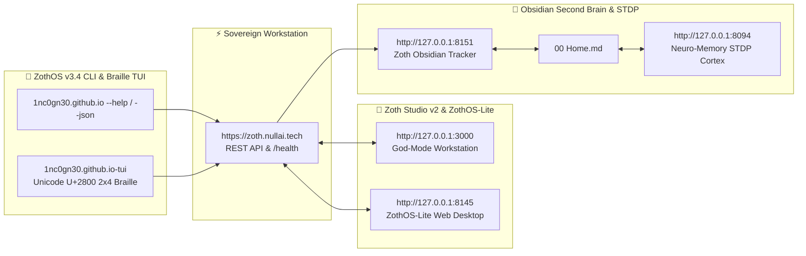

# 🕶️ 1nc0gn30 × GitHub — Sovereign Collab Portal (`https://1nc0gn30.github.io`)

[](https://1nc0gn30.github.io)
[](https://1nc0gn30.si)
[](https://nullai.tech)
[](https://zoth.nullai.tech)

Official **GitHub × 1nc0gn30 Collab Edition** portal hosted at **[https://1nc0gn30.github.io](https://1nc0gn30.github.io)**. Fuses GitHub Dark (`#0D1117`), Contribution Graph Emerald (`#39D353`), and 1nc0gn30 Sovereign Gold (`#D4AF37`) with a real-time **60fps 3D WebGL + Unicode `U+2800` 2×4 Sub-Pixel Braille + Ordered Bayer 8×8 Dither Engine**.

---

## ⚡ Key Architectural Features

1. **Interactive 3D WebGL + Unicode `U+2800` Braille & Bayer 8×8 Dither Stage**:
   - Switch live between **3 Render Modes**:
     - `3D + BRAILLE HYBRID` (wireframe WebGL projection + sub-pixel Braille overlay)
     - `PURE U+2800 BRAILLE` (2×4 sub-pixel character matrix)
     - `BAYER 8×8 DITHER` (ordered threshold matrix + ASCII luminance ramp)
   - Switch live between **3 Sacred 3D Geometries**:
     - `OCTO-MERKABA` (counter-rotating dual tetrahedra)
     - `CYBER TORUS` (parametric harmonic torus knot)
     - `BRAILLE SPHERE` (geodesic orbital lattice)
   - Includes drag-to-orbit rotation, auto-spin toggle, and 1-click **Copy ASCII/Braille Frame**.

2. **Interactive 52-Week Contribution & Activity Matrix**:
   - Live GitHub-style contribution heatmap across `@1nc0gn30` and `@NullAITech` repositories (`77` open-access tools: `55` browser + `22` CLI/daemon, `ZothOS v3.4.0`, `ZothOS-Lite v1.2`, `ZothNet`, `Hermes-Zoth`).

3. **Sovereign Ecosystem Funnel**:
   - **[1nc0gn30.si](https://1nc0gn30.si)** — Primary 1nc0gn30 portal for interactive tools, 360° Orbital Turntable Vortex, FieldKit, and resources.
   - **[nullai.tech](https://nullai.tech)** — NullAI Platform, Research Lab & Ghost Byte 3D Engine.
   - **[zoth.nullai.tech](https://zoth.nullai.tech)** — Zoth Studio v2 (77 free open-access tools: 55 in-browser + 22 CLI/daemon, all 77 public repos).
   - **[zothos.nullai.tech](https://zothos.nullai.tech)** — ZothOS v3.4.0 Debian 13 KDE Plasma 6 AI & Security Live OS (77 CLI tools, Agent Bridge `:8102`, Neuro-Memory `:8094`).
   - **[zothos-lite.nullai.tech](https://zothos-lite.nullai.tech)** — ZothOS-Lite v1.2 Tails-style Amnesic Monotone RAM-only (`toram`) OS (48+ models, 8 providers, ZothNet P2P mesh, USB/cloud persistence).
   - **[zothnet.nullai.tech](https://zothnet.nullai.tech)** — ZothNet Zero-Cloud Encrypted Mesh Network & 3-Hop Sphinx Mixnet.
   - **[github.com/1nc0gn30/hermes-zoth](https://github.com/1nc0gn30/hermes-zoth)** — Hermes-Zoth Nous Hermes Multi-Agent Orchestrator & Plugin.

---

## 🛠️ Local Development & Verification

```bash
# Serve locally on port 8190
python3 -m http.server 8190

# Verify zero overflow and zero console errors across mobile, tablet & desktop
node ~/.gemini/config/skills/ui-verification-loop/scripts/capture.mjs --base http://127.0.0.1:8190 --routes / --out /tmp/shots_gh_io --wait 1800
```

---

## ☕ Support & Patronage (100% Open-Access)

All tools and repositories are **100% free and open-access**:
- **Stripe "Buy Us a Coffee"**: [https://buy.stripe.com/3cIfZg27PdKo2D64Ocfw40X](https://buy.stripe.com/3cIfZg27PdKo2D64Ocfw40X)
- **Solana Tip Address**: `GG2eQbVh8ut1BK6j1A2tz7pSySdLpD38BgyEhGcxdXoK`

---

**Engineered by 1nc0gn30 (@1nc0gn30) • [1nc0gn30.si](https://1nc0gn30.si) • [NullAI Platform](https://nullai.tech)**

---

## 🏛️ ZothOS v3.4, Zoth Studio v2 & Obsidian Second Brain Ecosystem



### Cross-Surface Integration Matrix

| Surface | Endpoint / Binary | Capabilities |
| :--- | :--- | :--- |
| **Standalone Workstation** | `https://zoth.nullai.tech` | 100% Free & Open-Access Web Deck, live `/health` & REST telemetry |
| **Zoth Studio v2 Route** | `http://127.0.0.1:3000` | Interactive God-Mode component inside Zoth Studio (`https://zoth.nullai.tech`) |
| **ZothOS v3.4 CLI & TUI** | `1nc0gn30.github.io` / `1nc0gn30.github.io-tui` | Global binary in `/usr/local/bin/` with Unicode `U+2800` Braille TUI & `--json` output |
| **ZothOS-Lite Web Desktop** | `http://127.0.0.1:8145` | Browser-native KDE-style window manager & terminal launcher |
| **Zoth Obsidian Tracker** | `http://127.0.0.1:8151` | Interactive Obsidian Second Brain vault explorer (`~/Documents/Obsidian Vault/00 Home.md`) |
| **Neuro-Memory STDP Cortex** | `http://127.0.0.1:8094` | 3-Factor STDP synaptic memory daemon & 21-tool MCP server |

```bash
# Inspect CLI & Unicode U+2800 Braille TUI on ZothOS v3.4
1nc0gn30.github.io --help
1nc0gn30.github.io-tui --status
1nc0gn30.github.io-tui --json

# Verify Second Brain Vault & 12-Step Verification Gallery on :8151
zoth-obsidian-tracker --verify
```

